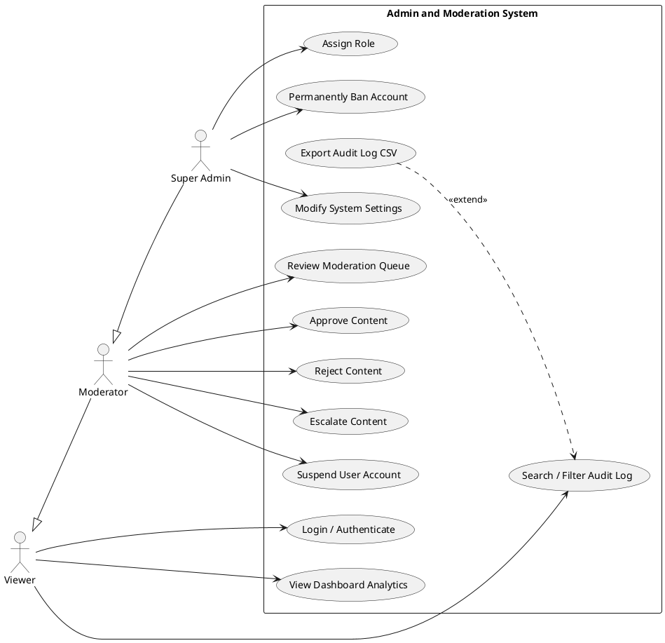
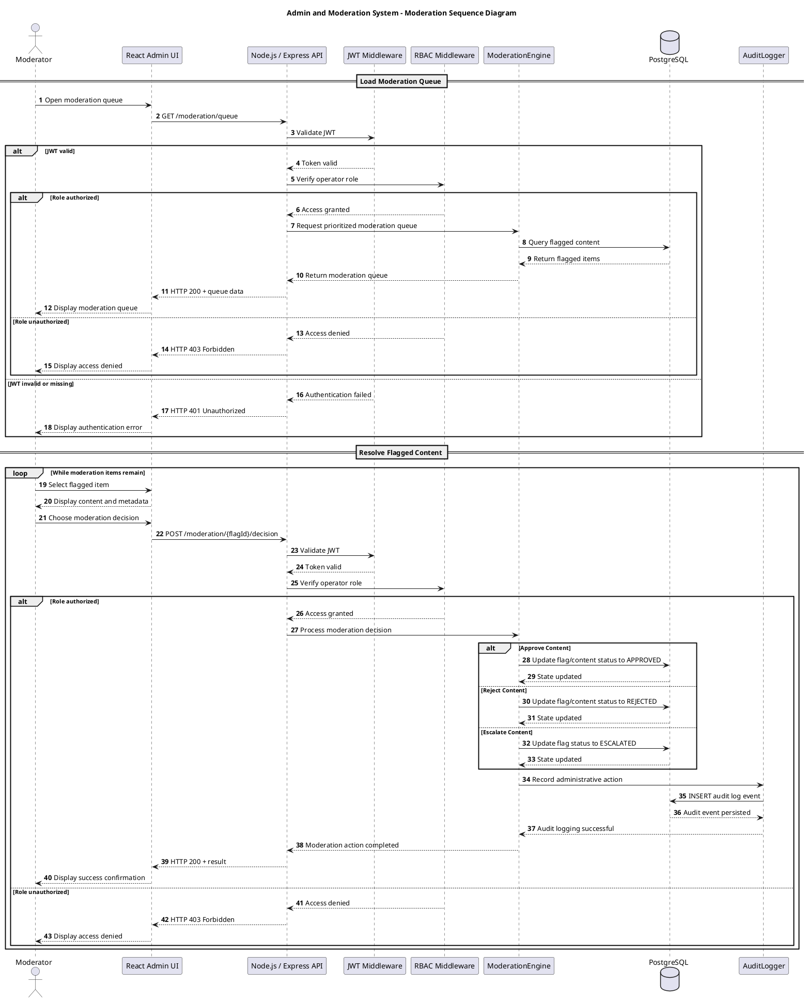
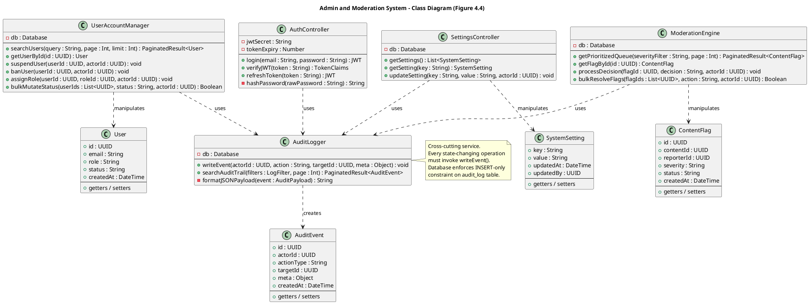
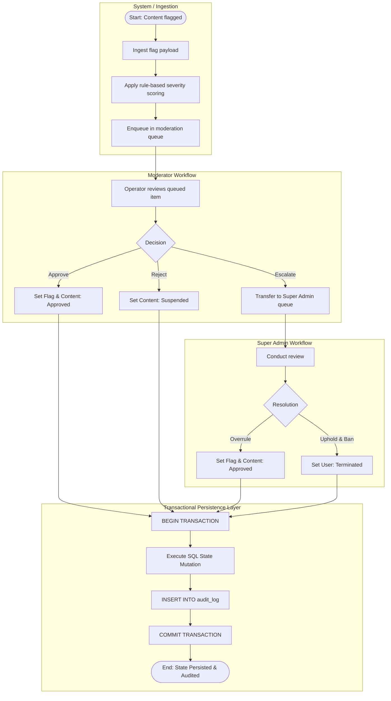
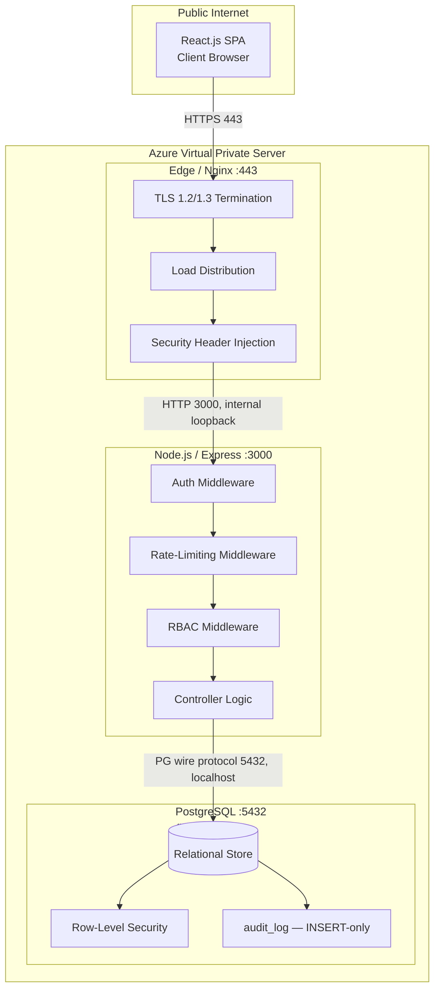

---
tags:
  - "#ics410XCSIInote"
links:
  - "[[ICS 410X CS Project II Notes MOC]]"
Created: 2026-09-10
Platform: Physical (LT 1)
---
# Diagrams used in the report
## Claude Use case diagram

## ChatGPT Sequence Diagram

## Grok Class Diagram

## claude entity-relationship diagram
```mermaid
erDiagram
    users ||--o{ flags : "reports"
    users }o--o{ roles : "user_roles"
    roles }o--o{ permissions : "role_permissions"
    content_items ||--o{ flags : "targets"
    users ||--o{ audit_log : "acts as (no cascade delete)"

    users {
        uuid id PK
        string email UK
        string password_hash
        boolean is_deleted
        timestamp created_at
    }

    roles {
        uuid id PK
        string name
    }

    permissions {
        uuid id PK
        string name
        string resource_type
    }

    role_permissions {
        uuid role_id PK FK
        uuid permission_id PK FK
    }

    user_roles {
        uuid user_id PK FK
        uuid role_id PK FK
    }

    content_items {
        uuid id PK
        string content_type
        uuid owner_id FK
        timestamp created_at
    }

    flags {
        uuid id PK
        uuid content_item_id FK
        uuid reported_by FK
        string severity
        string flag_status
        timestamp created_at
    }

    audit_log {
        uuid id PK
        uuid operator_id FK
        string action_type
        string target_entity_type
        uuid target_entity_id
        timestamp created_at
    }

    system_settings {
        string key PK
        string value
        timestamp updated_at
    }
```
## claude activity

## claude system architecture


